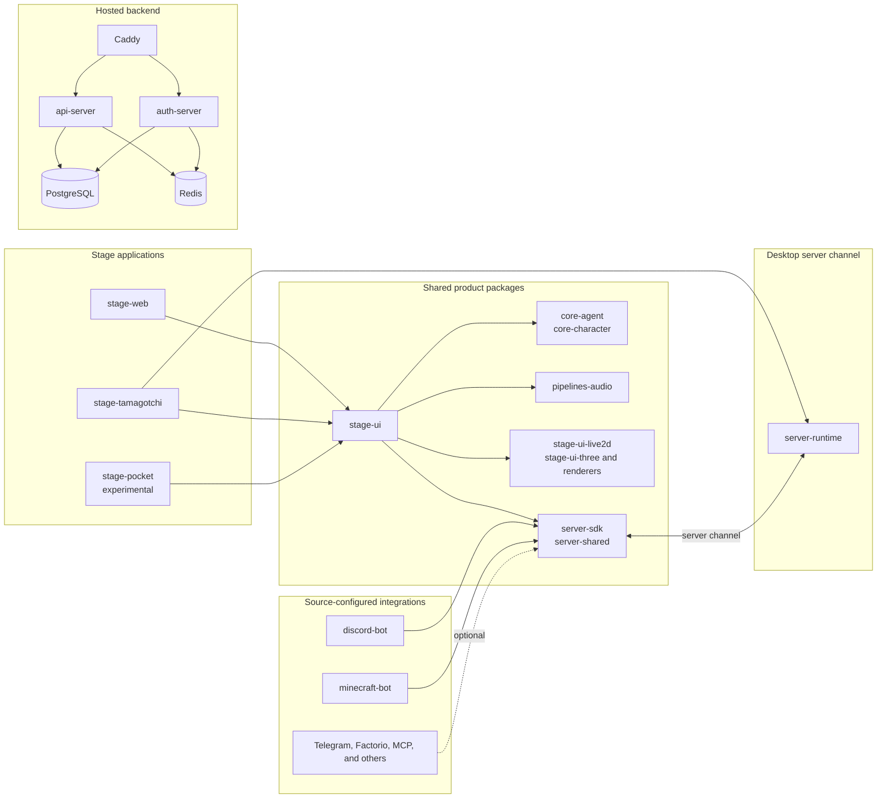

# Sofia

A personal companion you can talk to, watch, and hand tasks to. Sofia is a fork
of [Project AIRI](https://github.com/moeru-ai/airi) with her own identity, her own
stage, and her own brain.

She lives on a dark burgundy stage in the browser, drawn as a Live2D avatar. The
stage is served by a single-origin Node gateway (`apps/sofia-gateway`), which is
also her brain and hands: it proxies text turns to Hermes, bridges the browser to
Gemini Live for voice, and drives a separate Playwright browser service. The API
key never leaves the server.

## What she does

- Talks — by voice or by typing, in the same conversation
- Remembers — facts about you survive the conversation and every window
- Shows things — pages, images, and charts go on the stage beside her
- Acts on real pages — opens, clicks, fills, and reads what is on screen
- Arranges the stage — her own size and place, and the windows she opened
- Speaks first — she can open a subject instead of waiting to be asked

## This README

The sections from **Recent DevLogs & Stories** down describe the upstream project
this fork is built on, Project AIRI by the Moeru AI team. They are kept because
they document the shared engine, the provider list, and how to build and run the
monorepo, all of which still apply here. Where a command names upstream's own
hosting or repository, it will not reach Sofia's deployment.

For how this fork is deployed and what has been verified on it, see
[`docs/HANDOFF.md`](./docs/HANDOFF.md).
## Recent DevLogs & Stories

- [DevLog @ 2026.03.23: Mobile performance and game engine exploration](https://airi.moeru.ai/docs/en/blog/DevLog-2026.03.23/) - March 23, 2026
- [DevLog @ 2026.03.14: VRM stage lifecycle, cache, and observability](https://airi.moeru.ai/docs/en/blog/DevLog-2026.03.14/) - March 14, 2026
- [DevLog @ 2026.02.16: Dome Keeper data collection and training pipeline](https://airi.moeru.ai/docs/en/blog/DevLog-2026.02.16/) - February 16, 2026
- [DevLog @ 2026.01.01: AIRI Pocket and FlowChat memory experiments](https://airi.moeru.ai/docs/en/blog/DevLog-2026.01.01/) - January 1, 2026
- [DevLog @ 2025.10.20: Electron migration, new models, and Moeru AI updates](https://airi.moeru.ai/docs/en/blog/DevLog-2025.10.20/) - October 20, 2025
- [DevLog @ 2025.08.26: Pure vision progress for airi-factorio](https://airi.moeru.ai/docs/en/blog/DevLog-2025.08.26/) - August 26, 2025
- [DevLog @ 2025.08.05: AIRI v0.7 release highlights](https://airi.moeru.ai/docs/en/blog/DevLog-2025.08.05/) - August 5, 2025
- [DevLog @ 2025.08.01: Streaming text animation and grapheme clusters](https://airi.moeru.ai/docs/en/blog/DevLog-2025.08.01/) - August 1, 2025
- [DevLog @ 2025.07.18: Rethinking airi-factorio with Factorio Learning Environment](https://airi.moeru.ai/docs/en/blog/DevLog-2025.07.18/) - July 18, 2025
- [DreamLog 0x1: The backstory of Project AIRI](https://airi.moeru.ai/docs/en/blog/DreamLog-0x1/) - June 16, 2025
- More on the [documentation site](https://airi.moeru.ai/docs/en/)

## What's So Special About This Project?

Unlike the other AI driven VTuber open source projects, アイリ was built with support of many Web technologies such as [WebGPU](https://www.w3.org/TR/webgpu/), [WebAudio](https://developer.mozilla.org/en-US/docs/Web/API/Web_Audio_API), [Web Workers](https://developer.mozilla.org/en-US/docs/Web/API/Web_Workers_API/Using_web_workers), [WebAssembly](https://webassembly.org/), [WebSocket](https://developer.mozilla.org/en-US/docs/Web/API/WebSocket), etc. from the first day.

> [!TIP]
> Worrying about the performance drop since we are using Web related technologies?
>
> Don't worry, while the Web browser version is meant to give an insight into how much we can push and do inside browsers and webviews, we will never fully rely on this. The desktop version of AIRI is capable of using native [NVIDIA CUDA](https://developer.nvidia.com/cuda-toolkit) and [Apple Metal](https://developer.apple.com/metal/) by default (thanks to HuggingFace & the beloved [candle](https://github.com/huggingface/candle) project), without any complex dependency management. Considering the tradeoff, it is partially powered by Web technologies for graphics, layouts, animations, and the WIP plugin system for everyone to integrate things.

This means that **アイリ is capable of running on modern browsers and devices** and even on mobile devices (already done with PWA support). This brings a lot of possibilities for us (the developers) to build and extend the power of アイリ VTuber to the next level, while still leaving the flexibility for users to enable features that require TCP connections or other non-Web technologies such as connecting to a Discord voice channel or playing Minecraft and Factorio with friends.

> [!NOTE]
>
> We are still in the early stage of development where we are seeking out talented developers to join us and help us to make アイリ a reality.
>
> It's ok if you are not familiar with Vue.js, TypeScript, and devtools required for this project, you can join us as an artist, designer, or even help us to launch our first live stream.
>
> Even if you are a big fan of React, Svelte or even Solid, we welcome you. You can open a sub-directory to add features that you want to see in アイリ, or would like to experiment with.
>
> Fields (and related projects) that we are looking for:
>
> - Live2D modeller
> - VRM modeller
> - VRChat avatar designer
> - Computer Vision
> - Reinforcement Learning
> - Speech Recognition
> - Speech Synthesis
> - ONNX Runtime
> - Transformers.js
> - vLLM
> - WebGPU
> - Three.js
> - WebXR ([checkout the another project](https://github.com/moeru-ai/chat) we have under the @moeru-ai organization)
>
> **If you are interested, why not introduce yourself here? [Would like to join part of us to build AIRI?](https://github.com/moeru-ai/airi/discussions/33)**

## Current Progress & Roadmap

Capable of

- [x] Brain
  - [x] Play [Minecraft](https://www.minecraft.net)
  - [x] Play [Factorio](https://www.factorio.com) (WIP, but [PoC and demo available](https://github.com/moeru-ai/airi-factorio))
  - [x] Play [Kerbal Space Program](https://www.kerbalspaceprogram.com/) (announcement TBD)
  - [ ] Co-play [Helldivers 2](https://www.playstation.com/en-hk/games/helldivers-2/pc/) (WIP)
  - [x] Chat in [Telegram](https://telegram.org)
  - [x] Chat in [Discord](https://discord.com)
  - [ ] Memory
    - [x] Pure in-browser database support (DuckDB WASM | `pglite`)
    - [ ] Memory Alaya (WIP)
  - [ ] Pure in-browser local (WebGPU) inference
- [x] Ears
  - [x] Audio input from browser
  - [x] Audio input from [Discord](https://discord.com)
  - [x] Client side speech recognition
  - [x] Client side talking detection
- [x] Mouth
  - [x] Multi-provider voice synthesis, including [ElevenLabs](https://elevenlabs.io/), Microsoft/Azure Speech, OpenAI-compatible TTS, Alibaba Cloud Model Studio, and local Kokoro TTS
- [x] Body
  - [x] VRM support
    - [x] Control VRM model
  - [x] VRM model animations
    - [x] Auto blink
    - [x] Auto look at
    - [x] Idle eye movement
  - [x] Live2D support
    - [x] Control Live2D model
  - [x] Live2D model animations
    - [x] Auto blink
    - [x] Auto look at
    - [x] Idle eye movement

## Development

> For detailed instructions to develop this project, follow [CONTRIBUTING.md](./.github/CONTRIBUTING.md)

> [!NOTE]
> By default, `pnpm dev` will start the development server for the Stage Web (browser version). If you would
> like to try developing the desktop version, please make sure you read [CONTRIBUTING.md](./.github/CONTRIBUTING.md)
> to setup the environment correctly.

```shell
pnpm i
pnpm dev
```

### Stage Web (Browser Version at [airi.moeru.ai](https://airi.moeru.ai))

```shell
pnpm dev
```

### Stage Tamagotchi (Desktop Version)

```shell
pnpm dev:tamagotchi
```

A Nix package for Tamagotchi is included. To run airi with Nix, first make sure to enable flakes, then run:

```shell
nix run github:moeru-ai/airi
```

#### NixOS

Electron requires shared libraries that aren't in standard paths on NixOS. Use the FHS shell defined in `flake.nix`:

```shell
nix develop .#fhs
pnpm dev:tamagotchi
```

### Stage Pocket (Mobile Version)

Start the development server for the capacitor:

```shell
pnpm dev:pocket:ios --target "<DEVICE_ID_OR_SIMULATOR_NAME>"
# Or
CAPACITOR_DEVICE_ID_IOS="<DEVICE_ID_OR_SIMULATOR_NAME>" pnpm dev:pocket:ios
```

Quote the target: simulator names such as `iPhone 16 Pro` contain spaces.

You can see the list of available devices and simulators by running `pnpm -F @proj-airi/stage-pocket exec cap run ios --list`. `@capacitor/cli` is declared in `apps/stage-pocket`, so `cap` does not resolve from the repository root.

If you need to connect server channel on pocket in wireless mode, you need to start tamagotchi as root:

```shell
sudo pnpm dev:tamagotchi
```

Then enable secure websocket in tamagotchi `settings/connections`.

### Documentation Site

The documentation site lives in [moeru-ai/airi-docs](https://github.com/moeru-ai/airi-docs).

### Publish

Run `bumpp` to update the monorepo version:

```shell
npx bumpp --no-commit --no-tag
```

## Support of LLM API Providers (powered by [xsai](https://github.com/moeru-ai/xsai))

- [x] [AIHubMix (recommended)](https://aihubmix.com/?aff=OOiX)
- [x] [OpenRouter](https://openrouter.ai/)
- [x] [vLLM](https://github.com/vllm-project/vllm)
- [x] [SGLang](https://github.com/sgl-project/sglang)
- [x] [Ollama](https://github.com/ollama/ollama)
- [x] [302.AI (sponsored)](https://share.302.ai/514k2v)
- [x] [OpenAI](https://platform.openai.com/docs/guides/gpt/chat-completions-api)
  - [x] [Azure OpenAI API](https://learn.microsoft.com/en-us/azure/ai-services/openai/reference)
- [x] [Anthropic Claude](https://anthropic.com)
  - [ ] [AWS Claude](https://docs.anthropic.com/en/api/claude-on-amazon-bedrock) (PR welcome)
- [x] [DeepSeek](https://www.deepseek.com/)
- [x] [Qwen](https://help.aliyun.com/document_detail/2400395.html)
- [x] [Google Gemini](https://developers.generativeai.google)
- [x] [xAI](https://x.ai/)
- [x] [Groq](https://wow.groq.com/)
- [x] [Mistral](https://mistral.ai/)
- [x] [Cloudflare Workers AI](https://developers.cloudflare.com/workers-ai/)
- [x] [Together.ai](https://www.together.ai/)
- [x] [Fireworks.ai](https://fireworks.ai/)
- [x] [Novita](https://www.novita.ai/)
- [x] [Zhipu](https://bigmodel.cn)
- [x] [SiliconFlow](https://cloud.siliconflow.cn/i/rKXmRobW)
- [x] [Stepfun](https://platform.stepfun.com/)
- [x] [Baichuan](https://platform.baichuan-ai.com)
- [x] [Minimax](https://api.minimax.chat/)
- [x] [Moonshot AI](https://platform.moonshot.cn/)
- [x] [ModelScope](https://modelscope.cn/docs/model-service/API-Inference/intro)
- [x] [Player2](https://player2.game/)
- [x] [Tencent Cloud](https://cloud.tencent.com/document/product/1729)
- [ ] [Sparks](https://www.xfyun.cn/doc/spark/Web.html) (PR welcome)
- [ ] [Volcano Engine](https://www.volcengine.com/experience/ark?utm_term=202502dsinvite&ac=DSASUQY5&rc=2QXCA1VI) (PR welcome)
- [x] [Xiaomi Mimo](https://platform.xiaomimimo.com)

## Sub-projects Born from This Project

- [Awesome AI VTuber](https://github.com/proj-airi/awesome-ai-vtuber): A curated list of AI VTubers and related projects
- [`unspeech`](https://github.com/moeru-ai/unspeech): Universal endpoint proxy server for `/audio/transcriptions` and `/audio/speech`, like LiteLLM but for any ASR and TTS
- [`hfup`](https://github.com/moeru-ai/hfup): tools to help on deploying, bundling to HuggingFace Spaces
- [`xsai-transformers`](https://github.com/moeru-ai/xsai-transformers): Experimental [🤗 Transformers.js](https://github.com/huggingface/transformers.js) provider for [xsAI](https://github.com/moeru-ai/xsai).
- [WebAI: Realtime Voice Chat](https://github.com/proj-airi/webai-realtime-voice-chat): Full example of implementing ChatGPT's realtime voice from scratch with VAD + STT + LLM + TTS.
- [`@proj-airi/drizzle-duckdb-wasm`](https://github.com/moeru-ai/airi/tree/main/packages/drizzle-duckdb-wasm/README.md): Drizzle ORM driver for DuckDB WASM
- [`@proj-airi/duckdb-wasm`](https://github.com/moeru-ai/airi/tree/main/packages/duckdb-wasm/README.md): Easy to use wrapper for `@duckdb/duckdb-wasm`
- [AIRI Factorio](https://github.com/moeru-ai/airi-factorio): Allow AIRI to play Factorio.
- [AIRI DomeKeeper](https://github.com/proj-airi/game-playing-ai-dome-keeper): Allow AIRI to play DomeKeeper.
- [Factorio RCON API](https://github.com/nekomeowww/factorio-rcon-api): RESTful API wrapper for Factorio headless server console
- [`autorio`](https://github.com/moeru-ai/airi-factorio/tree/main/packages/autorio): Factorio automation library
- [`tstl-plugin-reload-factorio-mod`](https://github.com/moeru-ai/airi-factorio/tree/main/packages/tstl-plugin-reload-factorio-mod): Reload Factorio mod when developing
- [Velin](https://github.com/luoling8192/velin): Use Vue SFC and Markdown to write easy to manage stateful prompts for LLM
- [`demodel`](https://github.com/moeru-ai/demodel): Easily boost the speed of pulling your models and datasets from various of inference runtimes.
- [`inventory`](https://github.com/moeru-ai/inventory): Centralized model catalog and default provider configurations backend service
- [MCP Launcher](https://github.com/moeru-ai/mcp-launcher): Easy to use MCP builder & launcher for all possible MCP servers, just like Ollama for models!
- [🥺 SAD](https://github.com/moeru-ai/sad): Documentation and notes for self-host and browser running LLMs.



## Similar Projects

### Open sourced ones

- [kimjammer/Neuro: A recreation of Neuro-Sama originally created in 7 days.](https://github.com/kimjammer/Neuro): very well completed implementation.
- [SugarcaneDefender/z-waif](https://github.com/SugarcaneDefender/z-waif): Great at gaming, autonomous, and prompt engineering
- [semperai/amica](https://github.com/semperai/amica/): Great at VRM, WebXR
- [elizaOS/eliza](https://github.com/elizaOS/eliza): Great examples and software engineering on how to integrate agent into various of systems and APIs
- [ardha27/AI-Waifu-Vtuber](https://github.com/ardha27/AI-Waifu-Vtuber): Great about Twitch API integrations
- [InsanityLabs/AIVTuber](https://github.com/InsanityLabs/AIVTuber): Nice UI and UX
- [IRedDragonICY/vixevia](https://github.com/IRedDragonICY/vixevia)
- [t41372/Open-LLM-VTuber](https://github.com/t41372/Open-LLM-VTuber)
- [PeterH0323/Streamer-Sales](https://github.com/PeterH0323/Streamer-Sales)

### Non-open-sourced ones

- https://clips.twitch.tv/WanderingCaringDeerDxCat-Qt55xtiGDSoNmDDr https://www.youtube.com/watch?v=8Giv5mupJNE
- https://clips.twitch.tv/TriangularAthleticBunnySoonerLater-SXpBk1dFso21VcWD
- https://www.youtube.com/@NOWA_Mirai

## Project Status


## Acknowledgements

- [Reka UI](https://github.com/unovue/reka-ui): for designing the documentation site, the new landing page is based on this, as well as implementing a massive amount of UI components. (shadcn-vue is using Reka UI as the headless, do checkout!)
- [pixiv/ChatVRM](https://github.com/pixiv/ChatVRM)
- [josephrocca/ChatVRM-js: A JS conversion/adaptation of parts of the ChatVRM (TypeScript) code for standalone use in OpenCharacters and elsewhere](https://github.com/josephrocca/ChatVRM-js)
- Design of UI and style was inspired by [Cookard](https://store.steampowered.com/app/2919650/Cookard/), [UNBEATABLE](https://store.steampowered.com/app/2240620/UNBEATABLE/), and [Sensei! I like you so much!](https://store.steampowered.com/app/2957700/_/), and artworks of [Ayame by Mercedes Bazan](https://dribbble.com/shots/22157656-Ayame) with [Wish by Mercedes Bazan](https://dribbble.com/shots/24501019-Wish)
- [mallorbc/whisper_mic](https://github.com/mallorbc/whisper_mic)
- [`xsai`](https://github.com/moeru-ai/xsai): Implemented a decent amount of packages to interact with LLMs and models, like [Vercel AI SDK](https://sdk.vercel.ai/) but way small.

## Supporters

<p align="center">
  <strong>Thank you for supporting Project AIRI through OpenCollective, Patreon, and Ko-fi.</strong>
</p>

<p align="center">
  
</p>

## Special Thanks

Special thanks to all contributors for their contributions to Project AIRI ❤️

<a href="https://github.com/moeru-ai/airi/graphs/contributors">
  
</a>

## Star History

<a href="https://star-history.dera.page/#moeru-ai/airi&Date">
  <picture>
    <source media="(prefers-color-scheme: dark)" srcset="https://star-history.dera.page/svg?repos=moeru-ai/airi&type=Date&theme=dark" />
    <source media="(prefers-color-scheme: light)" srcset="https://star-history.dera.page/svg?repos=moeru-ai/airi&type=Date" />
    
  </picture>
</a>
